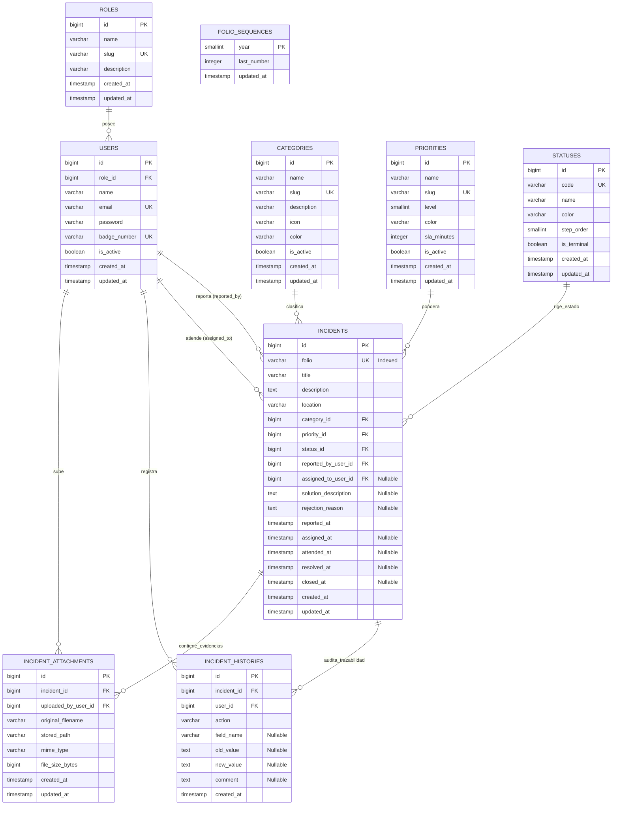

# MODELO CONCEPTUAL Y LÓGICO DE DATOS (POSTGRESQL)
## Proyecto: GIT — Gestión de Incidencias Tecnológicas (APOC / GTS)
**Motor Oficial de Base de Datos:** PostgreSQL 15+  
**Versión:** 1.0.0  
**Fecha:** Septiembre 2026  

---

### 1. DIAGRAMA ENTIDAD-RELACIÓN (MERMAID ERD)

---

### 2. DICCIONARIO DE DATOS TÉCNICO (TABLAS Y ESTRUCTURAS)

#### TABLA 1: `roles`
Catálogo de perfiles institucionales del sistema.
* `id`: `BIGSERIAL PRIMARY KEY`
* `name`: `VARCHAR(50) NOT NULL` (e.g. 'Operador APOC', 'Especialista GTS', 'Administrador')
* `slug`: `VARCHAR(30) NOT NULL UNIQUE` (e.g. 'apoc', 'gts', 'admin')
* `description`: `VARCHAR(255) NULL`
* `timestamps`: `created_at`, `updated_at`

#### TABLA 2: `users`
Cuentas de usuario autorizadas con credenciales seguras.
* `id`: `BIGSERIAL PRIMARY KEY`
* `role_id`: `BIGINT NOT NULL REFERENCES roles(id) ON DELETE RESTRICT`
* `name`: `VARCHAR(150) NOT NULL`
* `email`: `VARCHAR(150) NOT NULL UNIQUE`
* `password`: `VARCHAR(255) NOT NULL` (Hash Bcrypt/Argon2id)
* `badge_number`: `VARCHAR(50) NULL UNIQUE` (Número de gafete institucional aeroportuario)
* `is_active`: `BOOLEAN NOT NULL DEFAULT true`
* `remember_token`: `VARCHAR(100) NULL`
* `timestamps`: `created_at`, `updated_at`

#### TABLA 3: `categories`
Subsistemas tecnológicos aeroportuarios bajo cobertura de soporte.
* `id`: `BIGSERIAL PRIMARY KEY`
* `name`: `VARCHAR(100) NOT NULL` (e.g. 'CCTV y Videovigilancia', 'Control de Acceso')
* `slug`: `VARCHAR(50) NOT NULL UNIQUE` ('cctv', 'access-control', 'fids', 'tetra', 'networks')
* `description`: `TEXT NULL`
* `icon`: `VARCHAR(50) NOT NULL DEFAULT 'category'` (Material Symbols identifier)
* `color`: `VARCHAR(20) NOT NULL DEFAULT '#06B6D4'` (Código hexadecimal para UI)
* `is_active`: `BOOLEAN NOT NULL DEFAULT true`
* `timestamps`: `created_at`, `updated_at`

#### TABLA 4: `priorities`
Ponderación de criticidad operacional y SLA referencial.
* `id`: `BIGSERIAL PRIMARY KEY`
* `name`: `VARCHAR(50) NOT NULL` ('Baja', 'Media', 'Alta', 'Crítica')
* `slug`: `VARCHAR(30) NOT NULL UNIQUE` ('baja', 'media', 'alta', 'critica')
* `level`: `SMALLINT NOT NULL UNIQUE` (1 = Baja, 2 = Media, 3 = Alta, 4 = Crítica)
* `color`: `VARCHAR(20) NOT NULL`
* `sla_minutes`: `INTEGER NOT NULL DEFAULT 60` (Minutos objetivo para atención/resolución)
* `is_active`: `BOOLEAN NOT NULL DEFAULT true`
* `timestamps`: `created_at`, `updated_at`

#### TABLA 5: `statuses`
Estados operacionales del ciclo de vida (FSM).
* `id`: `BIGSERIAL PRIMARY KEY`
* `code`: `VARCHAR(30) NOT NULL UNIQUE` ('NUEVA', 'ASIGNADA', 'EN_ATENCION', 'RESUELTA', 'CERRADA')
* `name`: `VARCHAR(50) NOT NULL`
* `color`: `VARCHAR(20) NOT NULL`
* `step_order`: `SMALLINT NOT NULL UNIQUE` (Orden para Stepper visual 1 a 5)
* `is_terminal`: `BOOLEAN NOT NULL DEFAULT false` (True solo para 'CERRADA')
* `timestamps`: `created_at`, `updated_at`

#### TABLA 6: `folio_sequences`
Control atómico de numeración anual de folios para evitar colisiones en concurrencia.
* `year`: `SMALLINT PRIMARY KEY` (e.g. 2025, 2026)
* `last_number`: `INTEGER NOT NULL DEFAULT 0`
* `updated_at`: `TIMESTAMP WITH TIME ZONE NOT NULL DEFAULT NOW()`

#### TABLA 7: `incidents`
Entidad transaccional principal del sistema.
* `id`: `BIGSERIAL PRIMARY KEY`
* `folio`: `VARCHAR(30) NOT NULL UNIQUE` (Índice único e inmutable, formato `INC-YYYY-XXXX`)
* `title`: `VARCHAR(255) NOT NULL`
* `description`: `TEXT NOT NULL`
* `location`: `VARCHAR(255) NOT NULL` (e.g. 'Terminal 1 - Sala B', 'Pista 04R')
* `category_id`: `BIGINT NOT NULL REFERENCES categories(id) ON DELETE RESTRICT`
* `priority_id`: `BIGINT NOT NULL REFERENCES priorities(id) ON DELETE RESTRICT`
* `status_id`: `BIGINT NOT NULL REFERENCES statuses(id) ON DELETE RESTRICT`
* `reported_by_user_id`: `BIGINT NOT NULL REFERENCES users(id) ON DELETE RESTRICT`
* `assigned_to_user_id`: `BIGINT NULL REFERENCES users(id) ON DELETE RESTRICT`
* `solution_description`: `TEXT NULL`
* `rejection_reason`: `TEXT NULL`
* `reported_at`: `TIMESTAMP WITH TIME ZONE NOT NULL DEFAULT NOW()`
* `assigned_at`: `TIMESTAMP WITH TIME ZONE NULL`
* `attended_at`: `TIMESTAMP WITH TIME ZONE NULL`
* `resolved_at`: `TIMESTAMP WITH TIME ZONE NULL`
* `closed_at`: `TIMESTAMP WITH TIME ZONE NULL`
* `timestamps`: `created_at`, `updated_at`

#### TABLA 8: `incident_histories`
Bitácora cronológica inmutable de auditoría (Append-Only).
* `id`: `BIGSERIAL PRIMARY KEY`
* `incident_id`: `BIGINT NOT NULL REFERENCES incidents(id) ON DELETE CASCADE`
* `user_id`: `BIGINT NOT NULL REFERENCES users(id) ON DELETE RESTRICT`
* `action`: `VARCHAR(50) NOT NULL` ('CREADA', 'ASIGNADA', 'CAMBIO_ESTADO', 'NOTA_TECNICA', 'RESUELTA', 'CERRADA')
* `field_name`: `VARCHAR(100) NULL`
* `old_value`: `TEXT NULL`
* `new_value`: `TEXT NULL`
* `comment`: `TEXT NULL`
* `created_at`: `TIMESTAMP WITH TIME ZONE NOT NULL DEFAULT NOW()`

#### TABLA 9: `incident_attachments`
Metadatos de evidencias y adjuntos diagnósticos almacenados de forma segura.
* `id`: `BIGSERIAL PRIMARY KEY`
* `incident_id`: `BIGINT NOT NULL REFERENCES incidents(id) ON DELETE CASCADE`
* `uploaded_by_user_id`: `BIGINT NOT NULL REFERENCES users(id) ON DELETE RESTRICT`
* `original_filename`: `VARCHAR(255) NOT NULL`
* `stored_path`: `VARCHAR(500) NOT NULL` (Ruta relativa en disco privado)
* `mime_type`: `VARCHAR(100) NOT NULL`
* `file_size_bytes`: `BIGINT NOT NULL`
* `timestamps`: `created_at`, `updated_at`

---

### 3. ESTRATEGIA DE ÍNDICES Y OPTIMIZACIÓN (POSTGRESQL)

Para garantizar tiempos de respuesta menores a 250 ms en el Dashboard y búsquedas:
1. **Índice Único B-Tree:** `incidents(folio)` $\rightarrow$ Búsqueda instantánea desde el campo de búsqueda rápida del Header.
2. **Índice Compuesto Operacional:** `incidents(status_id, priority_id, created_at DESC)` $\rightarrow$ Alimenta la tarjeta de "Atención Inmediata" y la tabla 65% del Dashboard.
3. **Índice de Auditoría:** `incident_histories(incident_id, created_at ASC)` $\rightarrow$ Renderizado ultra-rápido de la línea de tiempo en el detalle de la incidencia.
4. **Integridad Referencial:** Todas las llaves foráneas críticas emplean `ON DELETE RESTRICT`, evitando que la eliminación accidental de un usuario o catálogo destruya la consistencia histórica del aeropuerto.

